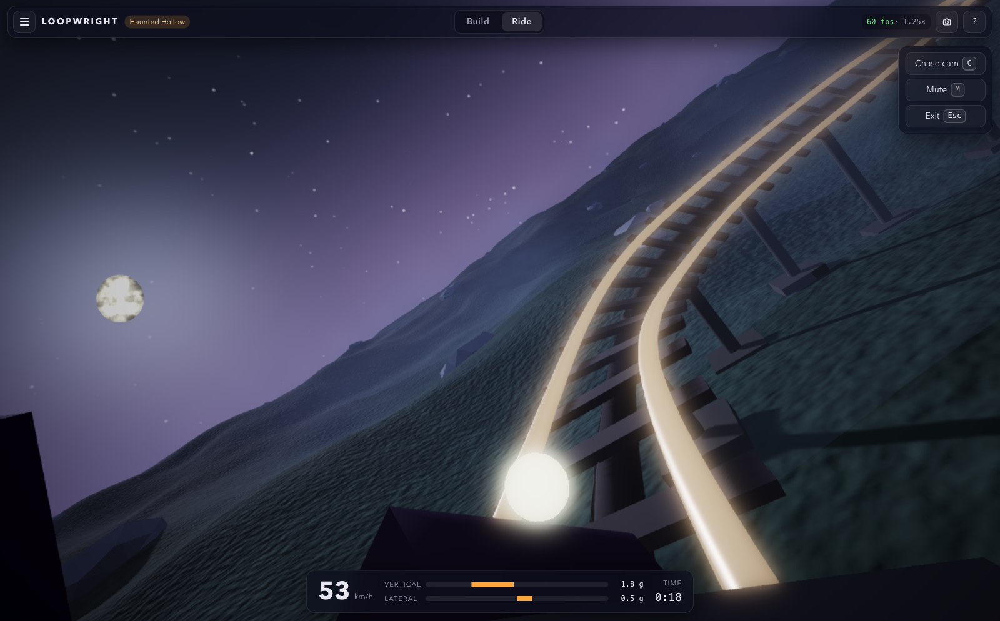

# Loopwright

Ride a glowing ball through a glowing glass tube at the speed you choose. Shape the track with
sliders, share it as a link, and switch the look with a key. Everything runs in the browser.



## What it is

Loopwright is ride first. The app opens on a ready-made track. Press `Enter` and you are inside
the tube, just behind the ball, looking ahead along the curve. The camera banks with the turns and
rolls through the loops. Speed comes from physics, faster after drops and slower on climbs, and a
multiplier slider from 0.25x to 3x stays live while you ride. `Shift` boosts, `P` pauses, and the
field of view, the streaks on the glass, the rings and the wind all follow your speed.

The track is a list of sections: straight (with an optional tunnel), hill, banked turn, loop,
corkscrew, helix coil, narrowing spiral, wave run and jump gap. Each has sliders, and the tube
reshapes while you drag. The track always closes itself with a smooth return section. Friendly
checks point at the section that goes underground, crosses itself or is pitched too tight.

The default look is Minimal: a soft dark gradient, gentle fog, a faint floor grid and a glass tube.
Six optional skins change only how things look, never the track or the ride: Haunted Hollow,
Primeval Valley and Xeno Reach are moods of sky and light; Frostline adds falling snow, pines with
white caps and string lights along the tube; Abyss puts the track under water with light rippling
on the sand, kelp, schools of fish and bubbles; Neon District rings the track with window-lit
towers and runs two neon rails beside the glass. Every theme has its own synthesised ambient
music bed, off by default.

On top of the ride sits a game. Steer the ball around the inside of the tube with the left and
right arrows to collect gold rings, worth more the faster you go and more again in a combo, hunt
the three faceted gems hidden on the harder lines, roll over boost pads for a burst, and steer
around the striped barriers that cut your speed and break the combo. Pads and barriers use every
lane, some pads come paired with a ring line on the far side so you choose, and weave runs
alternate barriers from side to side. Every lap is scored within its speed band and the best ten
laps are kept per track and band. Time Attack drops the items, races a ghost of your fastest lap
and shows the split at each section. Cruise mode is the pure ride.

Gems you collect add up across every track. They unlock nine ball skins and eight trails in the
locker (`L`), which also lists eighteen achievements, from the first gem to a perfect combo lap
and a lap in every theme. Progress stays in localStorage like everything else. A gamepad works
out of the box: the stick steers, the triggers change speed, A boosts.

## Stack

- [Babylon.js 9](https://www.babylonjs.com/) for the 3D engine, WebGL2
- TypeScript in strict mode
- [Svelte 5](https://svelte.dev/) for the HUD, timeline, inspector and dialogs, layered over the canvas
- Vite for dev and build, Vitest for unit tests, ESLint and Prettier
- Web Audio for synthesised wind, roll, item sounds and the ambient music beds (no audio files)
- No backend. Tracks autosave to localStorage, export as JSON and travel inside a URL hash.

All geometry is generated from the track frames and Babylon primitives. The tube is a custom mesh
with an additive glass shader; the ball, rings and supports are procedural. Nothing is downloaded
beyond the app itself.

## Run it

Requires Node 22 or newer.

```bash
npm ci
npm run dev      # http://localhost:5173
```

Other scripts:

```bash
npm run build    # type-check with svelte-check, then production build into dist/
npm run preview  # serve the production build
npm test         # Vitest unit tests
npm run lint     # ESLint and Prettier checks
npm run format   # Prettier write
```

## Controls

| Context  | Keys and mouse                                                                                  |
| -------- | ----------------------------------------------------------------------------------------------- |
| Anywhere | `Enter` or `Space` ride, and the same key or `Esc` returns to the editor                        |
| Ride     | `←` `→` (or `A` `D`) steer around the tube, `↑` `↓` nudge the speed multiplier                  |
| Ride     | hold `Shift` to boost, `P` pause, `C` Inside or Follow view, `Space` goes again after a lap     |
| Editor   | click the tube to select a section, `Delete` remove it, `Ctrl`/`Cmd+D` duplicate, `1` frame all |
| Editor   | `Ctrl`/`Cmd+Z` undo, `Shift+Ctrl`/`Cmd+Z` redo, a whole slider drag is one step                 |
| Orbit    | drag to orbit, right-drag to pan, scroll to zoom, `F` toggles the free-fly camera               |
| Anywhere | `T` next theme, `L` locker, `M` mute, `N` music, `O` save a photo, `?` or `H` shortcuts         |
| Gamepad  | left stick or d-pad steer, right and left trigger speed up and down, `A` boost, `B` ride        |
| Gamepad  | `Start` pause, `X` switch view; rings, gems and barriers rumble where the pad has haptics       |

On touch devices, left and right steering buttons sit at the bottom corners of the ride view.

The ride has two views. Inside sits just behind the ball; Follow sits further back so the ball
runs ahead of you. The camera lifts over crests and in airtime and squeezes in dips and loops,
driven by the g the ball feels at its effective speed, so the multiplier scales it. Each lap is
timed and the best lap is kept per track.

## The game

- Rings pay a base of 10 points plus 0.4 per km/h of effective speed, times a combo multiplier
  that grows 5% per ring without a miss up to double at twenty.
- Gems pay 500 and the HUD counts how many of the track's three you have found.
- Boost pads give a burst of extra speed for about a second, with a whoosh and a wider field.
- Hazards cut the base speed to under half, break the combo and lower what rings are worth until
  the ball has rebuilt its speed. There is no game over.
- Items come from the track and a seed with a deterministic generator, so a track always gets the
  same layout, saved with the track and inside its share link. The editor's Items toggle shows
  them while you shape the track and Reshuffle picks a new seed. Items keep 22 m clear before and
  after a barrier so there is time to react at 2x.
- Reading the track: a faint line traces each run of rings, a glowing strip on the wall marks the
  lane of the next barrier, and items ignore the fog so they show from far away.
- At the end of a lap a summary card shows score, rings, gems, best combo, top speed and lap
  time, and the lap joins the track's top ten in localStorage. Tables are kept per speed band:
  1x and under, up to 2x, and above 2x, judged by the highest slider setting used in the lap.
- Time Attack: no items, the fastest lap wins. A fastest lap in its band becomes a ghost, a
  translucent twin of the ball that rides alongside you next time, and each section entry shows
  the split against it.
- The first ride opens a short how-to card, remembered once dismissed; the shortcuts overlay can
  bring it back.
- Sound: a chime whose pitch climbs with the combo, a sparkle for gems, a whoosh for boosts and a
  thud for hazards. `M` mutes everything and the ride controls hold a master volume slider.
- Music: each theme has an ambient bed built live from oscillators, a detuned drone under a slow
  filter sweep and a melody that walks the theme's scale, with a pulse in Primeval Valley and Neon
  District. It is off by default; `N` or the Music button turns it on and it follows theme
  changes.

## Rewards

- Gems count across every track, the moment they are collected. Nine ball skins (Lattice,
  Meridian, Honeycomb, Ember, Orbit, Nova, Pulsar, Prism, Eclipse) and eight trails (Comet, Sparks,
  Stardust, Embers, Bubbles, Afterimage, Aurora, or none) unlock at gem thresholds from 2 to 50.
  Skins take the theme's ball colour, so they fit every world; the locker previews each one with
  the same painter that makes the ball's texture.
- Achievements: first gem, first lap, every ring on a track, a perfect combo lap, a lap with no
  barrier hit, every gem on a track, a lap above 2x, a twenty-ring combo, five pads in a lap,
  beating your ghost, gem and ring and lap milestones, five tracks, every theme and 250 km/h. Each
  shows a toast when earned and the locker lists them with the date.
- The locker opens with `L` or the gem button in the top bar, pauses a running ride, and keeps
  the equipped skin and trail in the saved prefs.

The Share button in the top bar renames the track, copies a link that rebuilds it with no server,
exports and imports JSON, and takes a photo. The track name opens the five starter tracks.

## Accessibility

With `prefers-reduced-motion` set, the field of view stays fixed, the streaks calm down, the
airtime and squeeze lift drops to a third, and the HUD drops its transitions.

## Project layout

```
src/engine/track/     sections, pose cursor, Dubins auto-close, spline, frames, track compiler
src/engine/tube/      the glass tube mesh and shader, light rings, supports, tunnel shells
src/engine/ride/      ball physics, the ball, the ride controller
src/engine/camera/    editor orbit and fly cameras, the inside ride camera
src/engine/edit/      section list, selection, undo with drag batching
src/engine/game/      item placement, scoring, the game controller, the item renderer, ghosts
src/engine/progress/  lifetime totals, unlock thresholds, achievements and their stores
src/engine/input/     the key registry and the gamepad reader
src/engine/validate/  track checks and the scene pins
src/engine/theme/     Minimal and the six skins, each with its props and music spec
src/engine/save/      track document, localStorage, the share codec, high scores
src/engine/starters/  the five starter tracks
src/engine/scene/     sky, lighting, fog and post-processing, floor, theme props, performance governor
src/engine/audio/     Web Audio wind, roll, item sounds and the music beds
src/ui/               Svelte 5 HUD, state and the single bridge module that talks to the engine
```

The engine never imports Svelte and the UI never imports Babylon. Track maths, physics,
validation, the edit history, item placement, scoring, high scores, the share codec, progress and
unlocks, achievements, the skin painter, the gamepad reader and the music helpers are pure
TypeScript and run under Vitest without a browser.

## Status

The ride, the slider editor, validation, five starter tracks, seven looks, sharing, the game layer,
speed bands and Time Attack, the locker with skins and trails, achievements, gamepad support and
the music beds are done.
See [ROADMAP.md](ROADMAP.md) for what comes next and [docs/PLAN.md](docs/PLAN.md) for the plan
this build followed.

## License

MIT, see [LICENSE](LICENSE).
